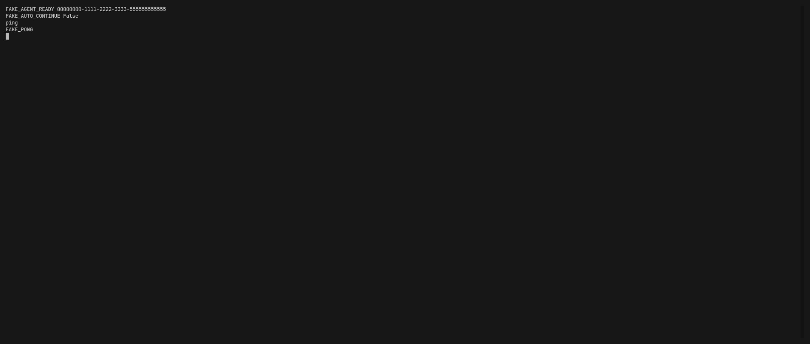

# tabby-agent-recovery

Restore Tabby panes after a restart.

Tabby already saves the main window layout. After a reboot the old PTY is gone, so a pane that used to hold a live session comes back as a new shell — or disappears if the process exited with `behaviorOnSessionEnd: auto`. This plugin rewrites the recovery token to a stable attach command, keeps the split tree, and starts bound panes without stealing focus.



## Install

Tabby → **Settings** → **Plugins** → search **agent-recovery** → Install → restart Tabby.

Or:

```bash
cd "$(tabby shows as Plugins Directory)"
npm install tabby-agent-recovery
```

Then restart Tabby. The package name must stay `tabby-agent-recovery` (`tabby-plugin` keyword) so the Plugin Manager lists it.

## What it does

- On save, bind a local pane to `agent-sessions attach <key>` when that launcher can identify the process.
- On recover, migrate the saved layout before Tabby builds tabs. Nested splits, titles, and ratios stay as they were.
- Bound panes use `behaviorOnSessionEnd: keep`, so a crash does not delete the tab from the layout.
- Bound background panes start their PTY without selecting the tab or focusing the window.
- A private layout snapshot is written once at launch, before autosave can replace it.

Without `agent-sessions`, already-bound reconnect commands (including scripts in `<state>/reconnect/*.sh`) still restore. Ordinary bash panes are left alone.

## Optional companion

An optional local `agent-sessions` launcher (`~/.local/bin/agent-sessions`) can keep agent dialogs alive in tmux when Tabby closes. The plugin talks to it through:

| Env | Default |
| --- | --- |
| `AGENT_SESSIONS_LAUNCHER` | `~/.local/bin/agent-sessions` |
| `AGENT_SESSIONS_STATE` | `~/.local/state/agent-sessions` if `state.json` exists, else `~/.local/state/tabby-agent-recovery` |
| `TABBY_AGENT_RECOVERY_LOG=1` | write pane output to `<state>/terminal-logs/` (off by default) |

State files are mode `0600`. They can contain paths, commands, and (if logging is on) terminal output. Nothing is uploaded.

## Already using the local copy

If Tabby already loads this plugin from a symlink under `~/.config/tabby/plugins/node_modules/tabby-agent-recovery`, do not also install it from the Plugin Manager — npm would replace that symlink.

## Development

```bash
npm test
TABBY_PLUGINS="$(pwd)" tabby --debug
```

## License

MIT
